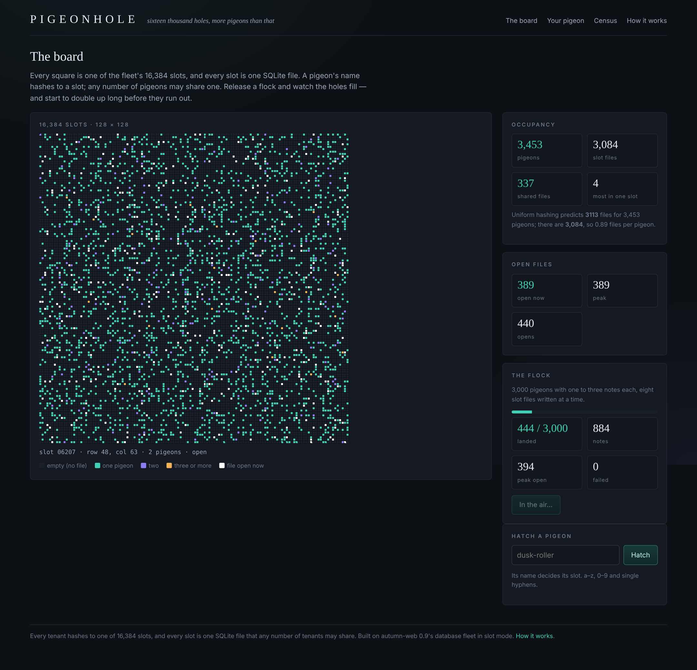
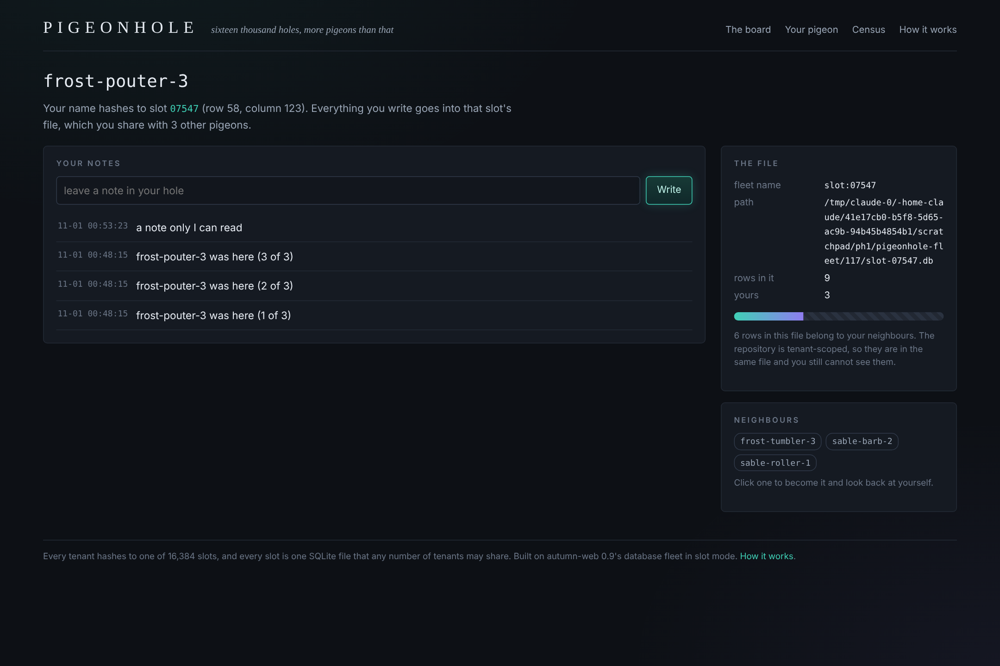
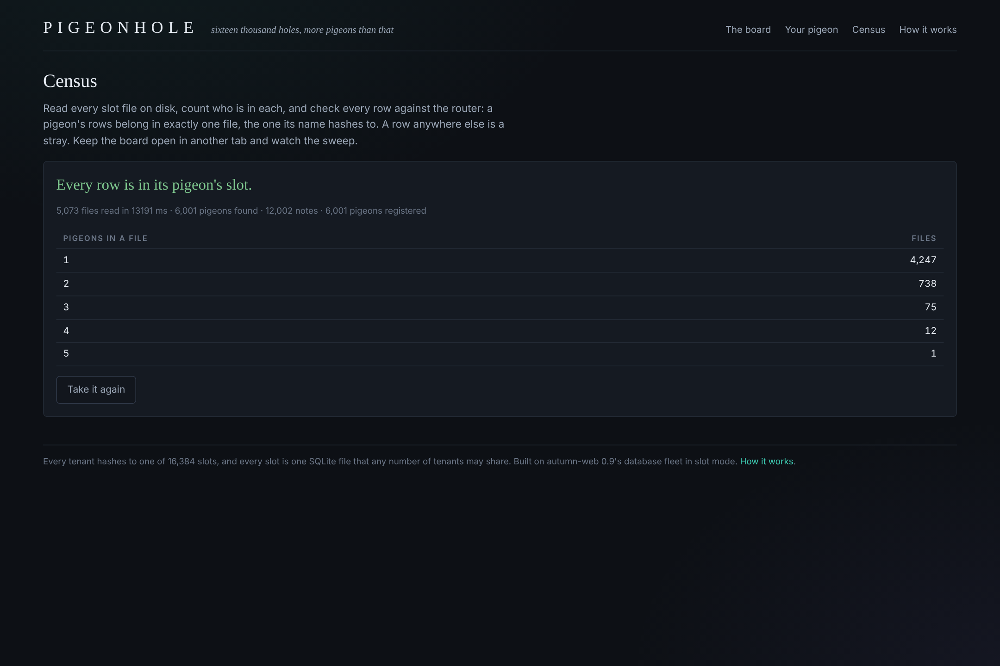

# Pigeonhole

**Sixteen thousand holes, more pigeons than that.** A test bed for
autumn-web 0.9's database fleet in **slot mode**: every tenant hashes to one of
16,384 slots, every slot is one SQLite file, and any number of tenants share
it.

```sh
cargo run -p pigeonhole-app   # then open http://localhost:3000
./verify.sh                   # the authoritative gate (toolchain, tests, boot, flow, audit, Verus)
```

No database server, no Docker. The control database and every slot file are
SQLite files beside the repo.



## What works today

- **The board** — all 16,384 slots as a 128 × 128 canvas: dark for no file,
  teal for one pigeon, violet for two, amber for three or more, white for a
  file the fleet has open right now (from a lifecycle hook on the fleet,
  pushed over SSE). Hover for the slot, click for who lives there.
- **Hatch a pigeon** — its name decides its slot. Slot files are created on
  first use (the slot-mode default).
- **Your pigeon** — notes through `#[repository(Note, tenant_scoped, sharded)]`,
  in a file you may share. The page shows the file's rows and yours side by
  side, and lists your neighbours: click one, become it, and look back.
- **Release a flock** — 3,000 pigeons, one to three notes each, eight slot files
  written at a time. The panel prints the birthday-problem prediction beside
  the real file count.
- **Census** — `Shards::each_shard` over every slot file on disk, checking every
  row against the router. A row in the wrong file is a stray; the tests plant
  one to prove it is caught.

| | |
|---|---|
|  |  |

## What it showed

- 3,000 pigeons land in **2,728 slot files against a predicted 2,742**; 250 files
  already hold two or more, at most four.
- Peak open **437 against `max_open = 64`**: the same soft ceiling Apiary found.
- A census of 2,728 files takes ~7 s and comes back clean.
- Two papercuts for the framework, in `docs/FINDINGS.md`.

## Layout

```
crates/holes            the engine: names, the slot board, the census fold, the flock plan
crates/pigeonhole-app   HTTP, the fleet, the registry
verus/src               grid.rs (the board is a bijection), census.rs (totals conserve)
docs/SPEC.md            what is formally and observably true, and a proof scoreboard
docs/adr                0001 slot mode · 0002 one migration set
```

## Verification

`./verify.sh` is the gate that counts. Cloud pre-check on 2026-10-31:
everything except Verus passed — 38 tests (18 engine unit + property, 13 app
unit, 6 HTTP integration against a real slot fleet, a 2,000-case property test
that the board routes exactly as the fleet does), `autumn routes audit` (62
routes, 0 unclassified), and the end-to-end flow (hatch → write → flock →
census). **The Verus has never been run**; `docs/SPEC.md` §5 ranks it.

## Where this could go

- **No login.** Anybody can be any pigeon; every route is deliberately
  `#[public]`.
- **Two hosts** splitting the slot range — the next build, Baton.
- **A bigger flock**, past the point where half the board is taken (~11,000).
- **One migration set** puts an empty `pigeons` table in every slot file (ADR
  0002).
